# ToDo Refactor Starter

Proyecto inicial para **ToDo Refactor Lab**: refactorización, pruebas unitarias y Pair Programming.

## Requisitos

- Node.js 18 o superior.
- npm, incluido con Node.js.

Comprueba las versiones instaladas:

```bash
node --version
npm --version
```

## Instalación

Clona el repositorio y entra en la carpeta del proyecto:

```bash
git clone <URL_DEL_REPOSITORIO>
cd todo-refactor-starter
```

Instala las dependencias:

```bash
npm install
```

## Ejecutar las pruebas

Ejecuta la suite de pruebas una vez:

```bash
npm test
```

Durante el desarrollo:

```bash
npm run test:watch
```

La primera prueba puede estar preparada para fallar: es el punto de partida de la
**Misión 2** y del ciclo **RED → GREEN → REFACTOR**.

## Ejecutar la aplicación

Abre `index.html` en un navegador o utiliza la extensión **Live Server** de
Visual Studio Code para servir el proyecto localmente. La aplicación se
encuentra en:

```text
http://localhost:5500/index.html
```

El puerto puede cambiar según la configuración de Live Server.

## Estructura

- `src/legacy.js`: código funcional simple para analizar antes de cambiar.
- `src/taskService.js`: lógica de dominio que completarás misión por misión.
- `src/app.js`: interfaz inicial; en la Misión 9 deberá delegar la lógica a `taskService.js`.
- `tests/taskService.test.js`: suite incremental de pruebas unitarias con Vitest.

## Registro RED → GREEN → REFACTOR

Documenta al menos una iteración:

- **RED:** Escribimos la prueba `alterna el estado completada de la tarea con el id especificado` para `cambiarEstado(tareas, id)` en `tests/taskService.test.js`. Falló porque la función aún lanzaba `Error("Misión 6 pendiente: implementar cambiarEstado()")`.
- **GREEN:** Implementamos el código mínimo utilizando `map()` e inmutabilidad: `tareas.map(t => t.id === id ? { ...t, completada: !t.completada } : t)`. Con esto la prueba pasó de inmediato a verde.
- **REFACTOR:** Verificamos que las demás tareas no mutaran por referencia (`expect(resultado).not.toBe(tareas)`) y que el objeto no alterara la colección original si el ID no existía, manteniendo una función puramente determinista sin efectos secundarios.

## Pair Programming

Registra por misión quién fue **Driver** y quién **Navigator**. Intercambien roles con frecuencia y no hagan commit hasta que ambos puedan explicar el código y la prueba.

## Misión 0 · Antes de modificar código

1. ¿Dónde almacenarías ahora el estado `completada` de una tarea?
   Lo almacenaría en el local storage usando de base un archivo JSON.
2. ¿Qué ocurriría si mañana cada tarea necesita prioridad, fecha o responsable?
   Se debería de añadir un nuevo atributo al objeto de la tarea, ya que se planeo desde antes como un objeto JSON.
3. ¿Qué parte del código representa datos y qué parte representa interfaz?
   La interfaz está en el archivo index.html y los datos están en el archivo App.js, aun que en el futuro se planea moverlos a un JSON y se modificaran desde el archivo TaskService.js
4. ¿Qué comportamiento debemos conservar durante el refactor?
   Todo el comportamiento observable y funcionalidad para el usuario final, por ejemplo los botones y listas.

### Tres comportamientos observables que NO deben cambiar

1. Agregar tareas al DOM
2. Eliminar tareas del DOM
3. Contador de tareas

## Misión 1

- Driver: Manuel

- Navigator: Uriel

Las tareas pasaron de texto a ser representadas como objetos, no hubo ninguna complicación en su implementación debido a su sencillez.

```javascript
let tareas = [
  {
    id: 0,
    titulo: "Revisar requisitos",
    completada: false,
  },
  {
    id: 1,
    titulo: "Diseñar pruebas",
    completada: false,
  },
  {
    id: 2,
    titulo: "Refactorizar código",
    completada: false,
  },
];
```

## Misión 2

- **Driver:** Manuel
- **Navigator:** Uriel

### RED: escribir la prueba unitaria

Antes de escribir el código de la función, usamos una prueba unitaria. Esta
prueba especifica cómo debe comportarse `crearTarea`.

Ejecutamos el comando de pruebas en la terminal:

```bash
npm test
```


La prueba falló porque la función `crearTarea` aún no existe o no devuelve lo
esperado. Esto confirma que la prueba realmente está verificando algo que aún
no se ha implementado.

### GREEN: implementar el código mínimo

Una vez comprobado que la prueba unitaria está lista, escribimos el código
mínimo necesario para que pase:

```javascript
return {
  id: id,
  titulo: titulo,
  completada: false,
};
```

Volvemos a ejecutar `npm test`.


Ahora la prueba aparece en verde, lo que indica que funcionó correctamente.

Con esta práctica entendimos mejor el propósito de las pruebas unitarias:
en lugar de realizar la prueba manualmente, solo se define el comportamiento y,
al ejecutar `npm test`, se verifica en milisegundos si la función devuelve el
objeto correcto.

## Misión 3

- **Driver:** Manuel
- **Navigator:** Uriel

Dada una lista de tareas y una nueva tarea, la función debe retornar una
colección que combine ambas. Para este problema, Uriel indicó que la solución
más sencilla, debido a su experiencia en el desarrollo web, sería utilizar el
operador spread (`...`). Este operador sirve para copiar todos los elementos
del arreglo original `tareas` y crear un nuevo arreglo.

```javascript
return [...tareas, nuevaTarea];
```

### Prueba 1: agregar una tarea a la lista

La prueba se diseñó para iniciar con el arreglo de tareas y la nueva tarea.
Después, se llama a `agregarTarea`. El resultado esperado es que la nueva
colección contenga `nuevaTarea`.

```javascript
describe("agregarTarea", () => {
  it("agrega una tarea a la lista existente", () => {
    // Arrange
    const tareasIniciales = [{ id: 1, titulo: "Tarea 1", completada: false }];
    const nuevaTarea = { id: 2, titulo: "Nueva tarea", completada: false };

    // Act
    const resultado = agregarTarea(tareasIniciales, nuevaTarea);

    // Assert
    expect(resultado).toContainEqual(nuevaTarea);
  });
});
```

### Prueba 2: Verificar que la nueva lista contiene un elemento extra

Se diseñó para comprobar que la nueva colección es más grande. Por ello, se
verifica que tenga un elemento más que la colección inicial; el resultado debe
ser `tareasIniciales.length + 1`.

```javascript
describe("agregarTarea", () => {
  it("incrementa en uno la cantidad total de tareas", () => {
    // Arrange
    const tareasIniciales = [{ id: 1, titulo: "Tarea 1", completada: false }];
    const nuevaTarea = { id: 2, titulo: "Tarea 2", completada: false };

    // Act
    const resultado = agregarTarea(tareasIniciales, nuevaTarea);

    // Assert
    expect(resultado.length).toBe(tareasIniciales.length + 1);
  });
});
```

### Prueba 3: Verifica que el nuevo arreglo no sea el mismo que el original (inmutabilidad)

Para detectar si agregarTarea está modificando directamente el arreglo original recibido, se comprueba que el nuevo arreglo no sea igual al original, además de comprobar que la copia de este sea idéntica al original para asegurar que ni el contenido ni la referencia del arreglo original sean alterados.

```javascript
describe("agregarTarea", () => {
  it("no muta el arreglo original de tareas", () => {
    // Arrange
    const tareasIniciales = [{ id: 1, titulo: "Tarea 1", completada: false }];
    const copiaInicial = [...tareasIniciales];
    const nuevaTarea = { id: 2, titulo: "Tarea 2", completada: false };

    // Act
    const resultado = agregarTarea(tareasIniciales, nuevaTarea);

    // Assert
    expect(resultado).not.toBe(tareasIniciales); // Referencias distintas
    expect(tareasIniciales).toEqual(copiaInicial); // El contenido original no cambia
  });
});
```

Una vez definidas las pruebas, ejecutamos `npm test` para comprobar que todo
está en orden.


El resultado es exitoso: las pruebas fueron satisfactorias, lo que indica que
las tres de agregar tarea fueron correctas.

## Misión 4

- **Driver:** Uriel
- **Navigator:** Manuel

Se implementó la función pura `buscarTarea(tareas, id)` para localizar un elemento específico dentro de la colección por su identificador único.

### RED: escribir las pruebas unitarias

Escribimos dos pruebas unitarias para cubrir ambos escenarios (existente e inexistente):

1. **ID existente:** Debe encontrar y retornar el objeto de la tarea correspondiente.
2. **ID inexistente:** Debe retornar `undefined` de manera determinista sin arrojar excepciones.

```javascript
describe("buscarTarea", () => {
  it("encuentra y retorna la tarea cuando el id existe", () => {
    // Arrange
    const tareas = [
      { id: 1, titulo: "Primera tarea", completada: false },
      { id: 2, titulo: "Segunda tarea", completada: true },
    ];

    // Act
    const resultado = buscarTarea(tareas, 2);

    // Assert
    expect(resultado).toEqual({
      id: 2,
      titulo: "Segunda tarea",
      completada: true,
    });
  });

  it("retorna undefined cuando el id no existe", () => {
    // Arrange
    const tareas = [{ id: 1, titulo: "Primera tarea", completada: false }];

    // Act
    const resultado = buscarTarea(tareas, 999);

    // Assert
    expect(resultado).toBeUndefined();
  });
});
```

Al correr `npm test`, la suite falló como se esperaba porque `buscarTarea` lanzaba el error pendiente de implementación.

### GREEN: implementar el código mínimo

Implementamos la función utilizando el método de arreglo estándar de JavaScript `find()`, el cual devuelve el primer elemento que satisface la condición o `undefined` si no se encuentra:

```javascript
export function buscarTarea(tareas, id) {
  return tareas.find((tarea) => tarea.id === id);
}
```

Al volver a ejecutar `npm test`, las 6 pruebas pasaron exitosamente (4 previas + 2 de la Misión 4).


## Misión 5

- **Driver:** Uriel
- **Navigator:** Manuel

En esta misión implementamos dos funciones de filtrado puro: `obtenerPendientes(tareas)` y `obtenerTerminadas(tareas)` para desacoplar el filtrado por estado de la vista.

### RED: escribir las pruebas unitarias

Siguiendo las pautas de diseño de software y TDD, diseñamos 3 pruebas para cada función cubriendo los 3 escenarios esenciales:

1. **Colección mixta:** Que se filtren únicamente las que corresponden al estado solicitado.
2. **Sin coincidencias:** Que devuelva un arreglo vacío `[]` cuando todas las tareas tengan el estado opuesto.
3. **Colección vacía:** Que maneje de forma segura un arreglo vacío inicial `[]` retornando `[]`.

```javascript
describe("obtenerPendientes", () => {
  it("filtra solo las tareas pendientes de una colección mixta", () => {
    const tareas = [
      { id: 1, titulo: "Tarea 1", completada: false },
      { id: 2, titulo: "Tarea 2", completada: true },
      { id: 3, titulo: "Tarea 3", completada: false },
    ];
    expect(obtenerPendientes(tareas)).toEqual([
      { id: 1, titulo: "Tarea 1", completada: false },
      { id: 3, titulo: "Tarea 3", completada: false },
    ]);
  });

  it("retorna arreglo vacío si no hay pendientes (todas terminadas)", () => {
    const tareas = [
      { id: 1, titulo: "Tarea 1", completada: true },
      { id: 2, titulo: "Tarea 2", completada: true },
    ];
    expect(obtenerPendientes(tareas)).toEqual([]);
  });

  it("retorna arreglo vacío cuando la colección está vacía", () => {
    expect(obtenerPendientes([])).toEqual([]);
  });
});

describe("obtenerTerminadas", () => {
  it("filtra solo las tareas terminadas de una colección mixta", () => {
    const tareas = [
      { id: 1, titulo: "Tarea 1", completada: false },
      { id: 2, titulo: "Tarea 2", completada: true },
      { id: 3, titulo: "Tarea 3", completada: true },
    ];
    expect(obtenerTerminadas(tareas)).toEqual([
      { id: 2, titulo: "Tarea 2", completada: true },
      { id: 3, titulo: "Tarea 3", completada: true },
    ]);
  });

  it("retorna arreglo vacío si no hay terminadas (todas pendientes)", () => {
    const tareas = [{ id: 1, titulo: "Tarea 1", completada: false }];
    expect(obtenerTerminadas(tareas)).toEqual([]);
  });

  it("retorna arreglo vacío cuando la colección está vacía", () => {
    expect(obtenerTerminadas([])).toEqual([]);
  });
});
```

Al correr `npm test`, fallaron las 6 nuevas pruebas comprobando la fase RED.

### GREEN: implementar el código mínimo

Utilizamos el método funcional inmutable `filter()`:

```javascript
export function obtenerPendientes(tareas) {
  return tareas.filter((tarea) => !tarea.completada);
}

export function obtenerTerminadas(tareas) {
  return tareas.filter((tarea) => tarea.completada);
}
```

Al reejecutar las pruebas, los 12 tests pasaron de inmediato en verde.

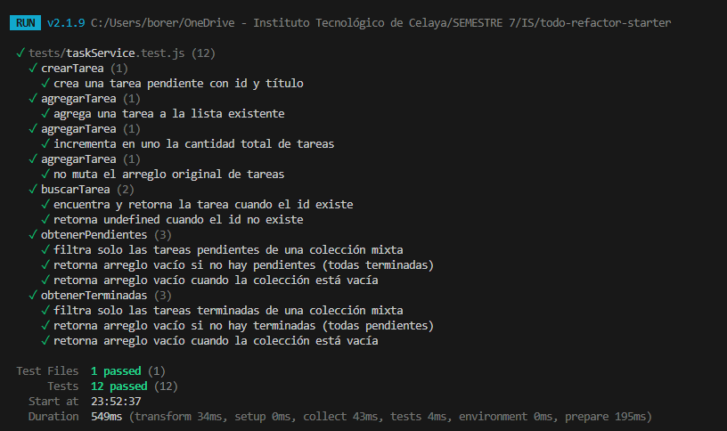

## Misión 6

- **Driver:** Uriel
- **Navigator:** Manuel

En esta misión se implementó `cambiarEstado(tareas, id)` para alternar la propiedad `completada` de una tarea manteniendo la inmutabilidad tanto del arreglo principal como de los objetos internos.

### RED: escribir las pruebas unitarias

Diseñamos 3 pruebas para validar el comportamiento esperado y garantizar que no haya efectos secundarios:

1. **Cambio de estado correcto:** Que invierta la propiedad `completada` (`false` a `true` o viceversa) de la tarea indicada.
2. **Inmutabilidad y preservación:** Que las demás tareas permanezcan intactas y no se muten las instancias originales en memoria.
3. **ID inexistente:** Que si no existe el identificador, devuelva un arreglo equivalente sin errores.

```javascript
describe("cambiarEstado", () => {
  it("alterna el estado completada de la tarea con el id especificado", () => {
    const tareas = [
      { id: 1, titulo: "Tarea 1", completada: false },
      { id: 2, titulo: "Tarea 2", completada: false },
    ];
    const resultado = cambiarEstado(tareas, 1);
    expect(resultado.find((t) => t.id === 1)).toEqual({
      id: 1,
      titulo: "Tarea 1",
      completada: true,
    });
  });

  it("mantiene intactas las demás tareas sin mutarlas", () => {
    const tareas = [
      { id: 1, titulo: "Tarea 1", completada: false },
      { id: 2, titulo: "Tarea 2", completada: false },
    ];
    const resultado = cambiarEstado(tareas, 1);
    expect(resultado.find((t) => t.id === 2)).toEqual({
      id: 2,
      titulo: "Tarea 2",
      completada: false,
    });
    expect(resultado).not.toBe(tareas);
    expect(tareas[0].completada).toBe(false);
  });

  it("retorna una copia equivalente si el id no existe", () => {
    const tareas = [{ id: 1, titulo: "Tarea 1", completada: false }];
    const resultado = cambiarEstado(tareas, 999);
    expect(resultado).toEqual(tareas);
    expect(resultado).not.toBe(tareas);
  });
});
```

Al ejecutar `npm test`, las 3 pruebas fallaron confirmando la fase RED.

### GREEN: implementar el código mínimo

Implementamos `cambiarEstado` mediante `map()` y el operador spread `{ ...tarea }` para crear una copia inmutable únicamente del elemento modificado:

```javascript
export function cambiarEstado(tareas, id) {
  return tareas.map((tarea) =>
    tarea.id === id ? { ...tarea, completada: !tarea.completada } : tarea,
  );
}
```

Al volver a ejecutar `npm test`, las 15 pruebas pasaron en verde.

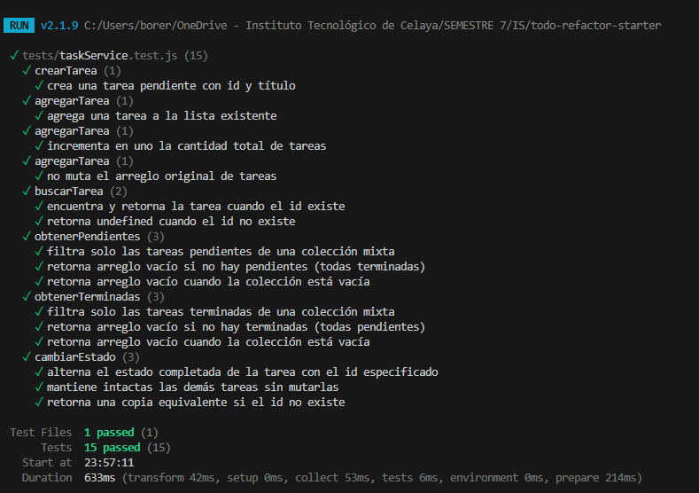

### Misión 7

- **Driver:** Manuel
- **Navigator:** Uriel

Para implementar el método `eliminarTarea(tareas, id)`, tomamos en cuenta la
pista proporcionada: «conserva todas excepto una». Por eso decidimos utilizar
la función `filter`, que recibe la lista y devuelve una nueva con todas las
tareas cuyo identificador es diferente del que se desea eliminar.

```javascript
export function eliminarTarea(tareas, id) {
  return tareas.filter((tarea) => tarea.id !== id);
}
```

Se diseñaron tres pruebas para diferentes situaciones al momento de eliminar
tareas:

- Cuando se elimina una tarea con el identificador especificado.
- Cuando se intenta eliminar una tarea que no existe.
- Cuando se intenta eliminar una colección vacía.

```javascript
describe("eliminarTarea", () => {
  it("elimina la tarea con el id especificado", () => {
    // Arrange
    const tareas = [
      { id: 1, titulo: "Tarea 1", completada: false },
      { id: 2, titulo: "Tarea 2", completada: false },
    ];

    // Act
    const resultado = eliminarTarea(tareas, 1);

    // Assert
    expect(resultado).toEqual([
      { id: 2, titulo: "Tarea 2", completada: false },
    ]);
  });

  it("retorna una copia equivalente si el id no existe", () => {
    // Arrange
    const tareas = [{ id: 1, titulo: "Tarea 1", completada: false }];

    // Act
    const resultado = eliminarTarea(tareas, 999);

    // Assert
    expect(resultado).toEqual(tareas);
    expect(resultado).not.toBe(tareas);
  });

  it("retorna arreglo vacío cuando la colección está vacía", () => {
    // Act
    const resultado = eliminarTarea([], 1);

    // Assert
    expect(resultado).toEqual([]);
  });
});
```

Una vez definidas las pruebas, ejecutamos `npm test` para comprobar que todo
está en orden. Las tres pruebas de eliminación de tareas pasaron sin fallos.

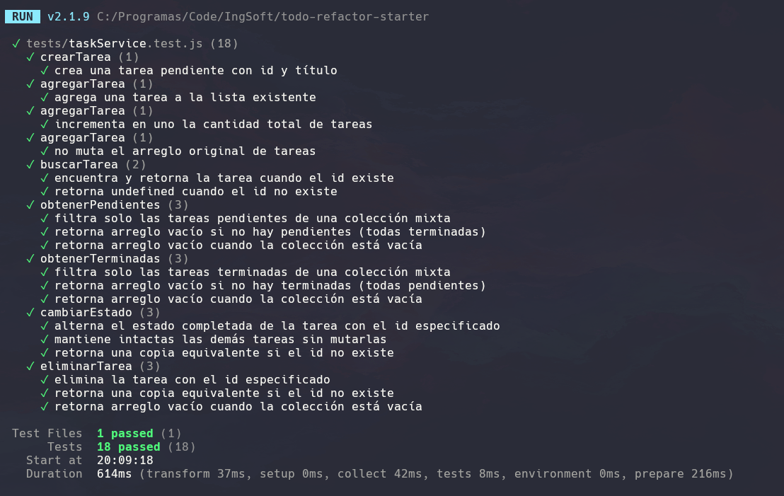

## Misión 8

- **Driver:** Manuel
- **Navigator:** Uriel

La implementación de la función `obtenerResumen(tareas)` debe devolver un
objeto con las siguientes características:

```javascript
{
  total: 5,
  pendientes: 3,
  completadas: 2
}
```

Para calcular el total, basta con utilizar la propiedad `.length` de la lista.
Para obtener la cantidad de tareas pendientes y completadas, reutilizamos las
funciones creadas en la Misión 5: `obtenerPendientes(tareas)` y
`obtenerTerminadas(tareas)`. De esta forma, solo necesitamos consultar la
longitud de cada resultado, en lugar de repetir la lógica de filtrado.

```javascript
export function obtenerResumen(tareas) {
  const total = tareas.length;
  const completadas = this.obtenerTerminadas(tareas).length;
  const pendientes = this.obtenerPendientes(tareas).length;

  return {
    total,
    completadas,
    pendientes,
  };
}
```

¿Cuál comunica mejor la intención?

La implementación que reutiliza funciones ya creadas y probadas, porque expresa
claramente que el resumen se construye a partir de los filtros existentes.

¿Cuál hace más trabajo?

La implementación que realiza el cálculo nuevamente, porque repite una lógica
que ya existe. Es preferible mantener el código dividido en funciones
pequeñas y reutilizables.

¿Cuál es más fácil de mantener?

La implementación que reutiliza las funciones existentes, ya que cualquier
cambio en la lógica de filtrado se realiza en un solo lugar.

```javascript
describe("obtenerResumen", () => {
  it("devuelve el resumen de tareas", () => {
    // Arrange
    const tareas = [
      { id: 1, titulo: "Tarea 1", completada: false },
      { id: 2, titulo: "Tarea 2", completada: true },
    ];

    // Act
    const resultado = obtenerResumen(tareas);

    // Assert
    expect(resultado).toEqual({
      total: 2,
      pendientes: 1,
      completadas: 1,
    });
  });

  it("retorna resumen vacío cuando la colección está vacía", () => {
    // Act
    const resultado = obtenerResumen([]);

    // Assert
    expect(resultado).toEqual({
      total: 0,
      completadas: 0,
      pendientes: 0,
    });
  });
});
```

Para diseñar las pruebas, se consideraron dos escenarios principales. El
primero utiliza una colección con tareas pendientes y completadas para
comprobar que `total`, `pendientes` y `completadas` se calculen correctamente.
El segundo utiliza una colección vacía para verificar que la función devuelva
ceros en todos los contadores y no produzca errores. En ambos casos, las
aserciones comparan el objeto completo, por lo que también validan los nombres
y los valores de todas sus propiedades.

Una vez definidas las pruebas, ejecutamos `npm test` para comprobar que todo
está en orden. Las dos pruebas de `obtenerResumen` pasaron sin fallos.

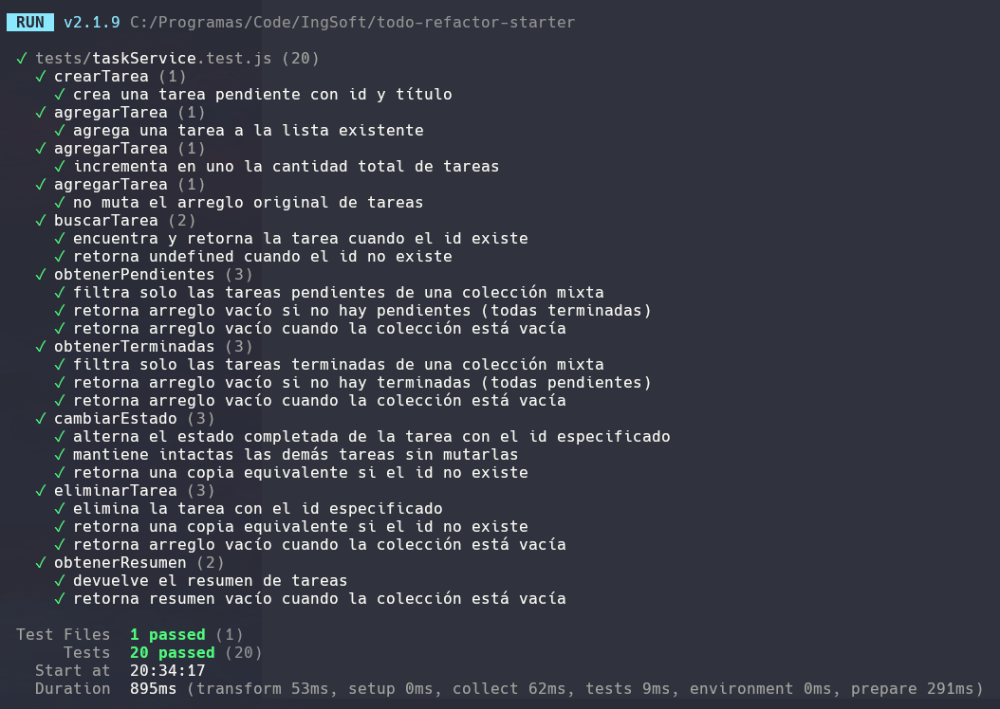

## Misión 9

- **Driver:** Manuel
- **Navigator:** Uriel

En esta misión se integró `taskService.js` con `app.js`. El DOM funciona como
adaptador: recibe los eventos del usuario, delega las reglas al servicio,
actualiza el estado de `tareas` y vuelve a representar la interfaz mediante
`render()`.

El flujo verificado fue:

```text
evento del usuario
↓
app.js
↓
taskService.js
↓
nuevo estado
↓
render()
↓
DOM
```

### Prueba 1: alta válida

**Pasos:**

1. Escribir un título en el campo de nueva tarea.
2. Presionar el botón «Agregar».

**Resultado esperado:** aparece una nueva tarea pendiente y se actualiza el
resumen con los contadores correspondientes.

**Resultado observado:** inicialmente se intentó mostrar cada elemento como si
fuera un texto, aunque después de la refactorización las tareas son objetos.
Por ese motivo, la interfaz mostraba un resultado incorrecto.

**Corrección:** se actualizó `render()` para acceder a la propiedad
`tarea.titulo` y representar cada tarea a partir de sus propiedades:

```javascript
tareasVisibles.forEach((tarea) => {
  const li = document.createElement("li");
  const title = document.createElement("span");
  title.className = "title";
  title.textContent = tarea.titulo;
  li.append(title);
  list.appendChild(li);
});
```

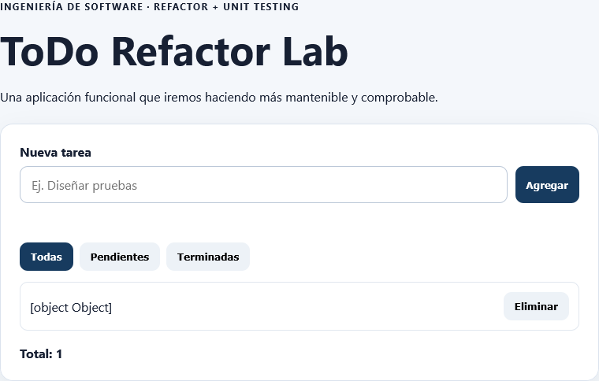

Después de la corrección, la tarea se muestra correctamente y permanece en
estado pendiente.

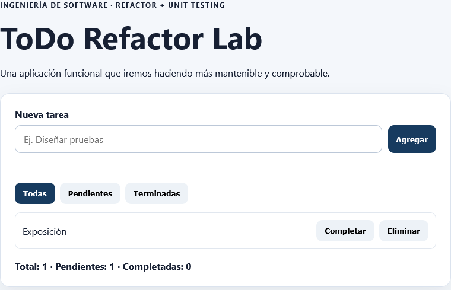

### Prueba 2: alta inválida

**Pasos:** intentar agregar una tarea sin escribir un título.

**Resultado esperado:** no se agrega ninguna tarea y aparece un mensaje
indicando que se debe escribir un título.

**Resultado observado:** la validación funciona correctamente; la lista y el
resumen permanecen sin cambios.

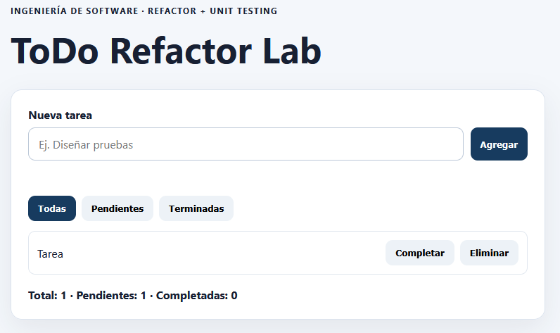

### Prueba 3: cambio de estado

**Pasos:** presionar «Completar» en una tarea pendiente.

**Resultado esperado:** la tarea cambia a completada, se muestra con el estilo
de tarea terminada y se actualizan los contadores.

**Resultado observado:** la tarea aparece tachada, cambia su estilo visual y el
resumen refleja una tarea pendiente menos y una tarea completada más.

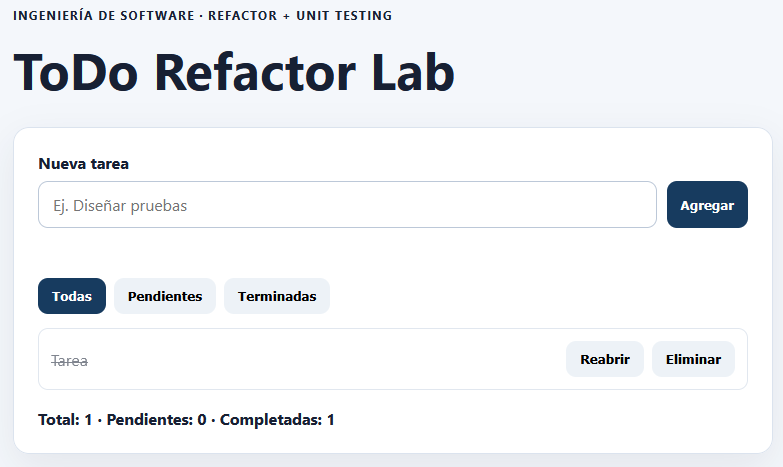

### Prueba 4: filtrado

**Pasos:**

1. Crear dos tareas.
2. Marcar una de ellas como completada.
3. Seleccionar el filtro «Pendientes».

**Resultado esperado:** solo se muestran las tareas pendientes. El resumen
continúa mostrando el total global de tareas: en este caso, dos tareas en
total, una pendiente y una completada.

**Resultado observado:** el filtro muestra únicamente la tarea pendiente y los
contadores se mantienen correctos, por lo que la integración funciona.

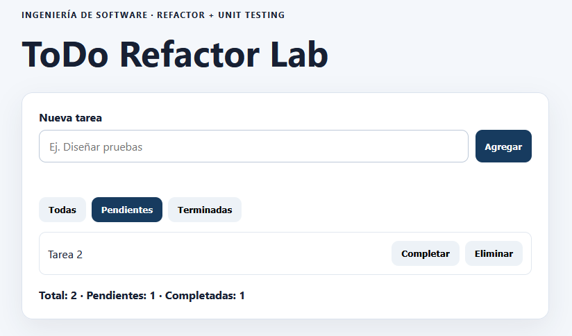

### Prueba 5: eliminación

**Pasos:** presionar «Eliminar» en una tarea existente.

**Resultado esperado:** la tarea desaparece de la lista y el resumen se
actualiza sin afectar las demás tareas.

**Resultado observado:** la tarea se elimina correctamente y el resumen se
actualiza después de volver a ejecutar `render()`.

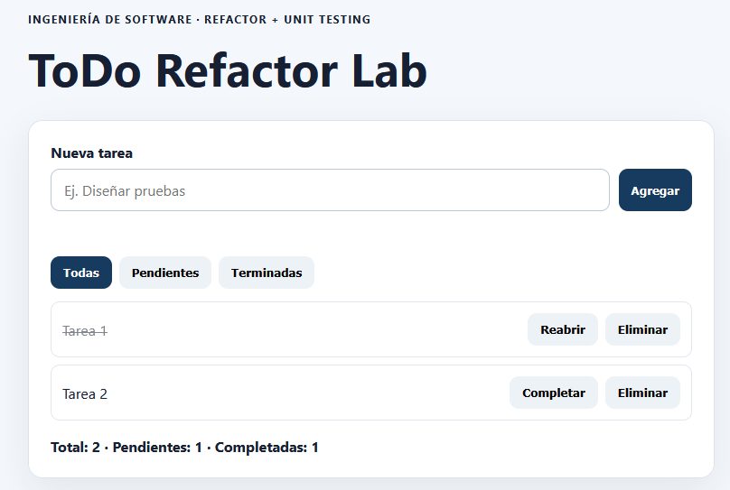

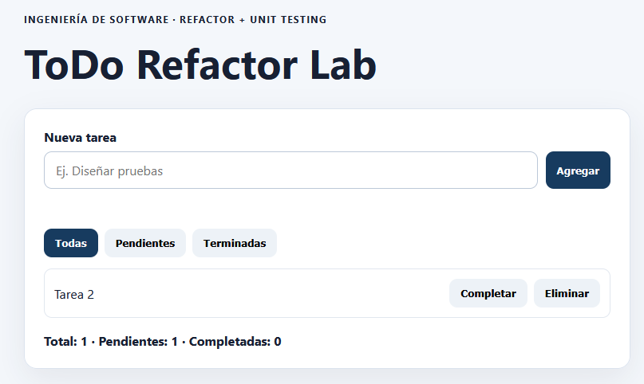

Estas pruebas confirmaron que la interfaz ya no contiene la lógica de negocio
principal. `app.js` se encarga de leer eventos y representar el estado,
mientras que `taskService.js` conserva las operaciones sobre las tareas y se
mantiene protegido por pruebas unitarias.

## Misión 10 · Refactor final protegido por pruebas

- **Driver:** Uriel
- **Navigator:** Manuel

Con la totalidad de la suite de pruebas unitarias en verde (20/20), realizamos una revisión de diseño, legibilidad y cohesión tanto en `taskService.js` como en `app.js`:

### 1. Refactorizaciones aplicadas

1. **Property Shorthand en `crearTarea` (`src/taskService.js`):**
   - Se simplificó la asignación explícita `id: id, titulo: titulo` a la sintaxis moderna `{ id, titulo, completada: false }`, mejorando la concisión sin alterar el contrato.
2. **Extracción de responsabilidad en `app.js` (`calcularSiguienteId`):**
   - El cálculo del identificador incremental dentro del manejador del evento `submit` se extrajo a una función pura independiente `calcularSiguienteId(listaTareas)`. Esto reduce la complejidad ciclomática del controlador de eventos y aumenta la cohesión del módulo.
3. **Legibilidad y orden en el resumen:**
   - Se unificó la denominación del modelo para garantizar que las propiedades calculadas mantengan una correspondencia directa entre la lógica de dominio y los contadores de la vista.

### 2. Comprobación con la red de seguridad

Tras cada pequeño cambio estructural, se ejecutó `npm test` para asegurar que ningún comportamiento observable haya sufrido alteraciones accidentales:

```bash
npm test
```

Los 20 casos de prueba continúan pasando al 100%, validando que el refactor preservó intacto el funcionamiento del sistema.

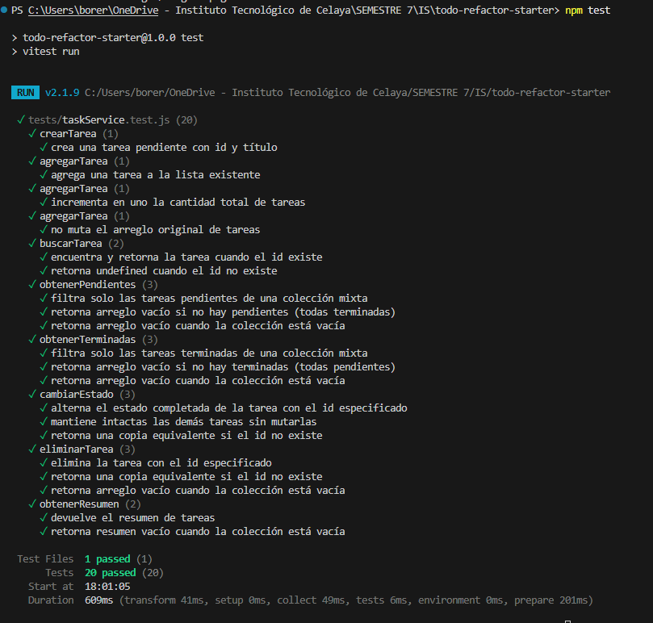

## Misión 11 · Nuevo requerimiento (Opción B: Buscar por texto)

- **Driver:** Uriel
- **Navigator:** Manuel

Para comprobar si la arquitectura resultante del refactor facilita la extensión de software sin acoplamiento ni regresiones, implementamos la **Opción B: Buscar por texto** mediante la disciplina TDD (RED → GREEN).

### Pregunta de prueba y diseño
> **¿La búsqueda debe ignorar mayúsculas y minúsculas?**  
> Sí. Para garantizar una experiencia de usuario óptima y robusta, la comparación debe ser normalizada (`toLowerCase()`) e ignorar espacios vacíos accidentales (`trim()`).

### RED: escribir las pruebas unitarias

Diseñamos 4 pruebas en `tests/taskService.test.js` para cubrir todos los escenarios:
1. **Insensibilidad a mayúsculas/minúsculas:** Buscar `"SOFTWARE"` debe encontrar `"Revisar requisitos de software"`.
2. **Coincidencia parcial:** Buscar `"prue"` debe localizar `"Diseñar pruebas unitarias"`.
3. **Sin coincidencias:** Buscar un término inexistente retorna un arreglo vacío `[]`.
4. **Término vacío o con espacios:** Buscar `"   "` no debe filtrar nada y debe devolver la lista completa intacta.

```javascript
describe("buscarPorTexto", () => {
  const tareasPrueba = [
    { id: 1, titulo: "Revisar requisitos de software", completada: false },
    { id: 2, titulo: "Diseñar pruebas unitarias", completada: true },
    { id: 3, titulo: "Refactorizar código limpio", completada: false }
  ];

  it("encuentra tareas ignorando mayúsculas y minúsculas", () => {
    const resultado = buscarPorTexto(tareasPrueba, "SOFTWARE");
    expect(resultado).toEqual([
      { id: 1, titulo: "Revisar requisitos de software", completada: false }
    ]);
  });

  it("encuentra tareas por coincidencia parcial de texto", () => {
    const resultado = buscarPorTexto(tareasPrueba, "prue");
    expect(resultado).toEqual([
      { id: 2, titulo: "Diseñar pruebas unitarias", completada: true }
    ]);
  });

  it("devuelve arreglo vacío cuando no hay coincidencias", () => {
    const resultado = buscarPorTexto(tareasPrueba, "arquitectura cloud");
    expect(resultado).toEqual([]);
  });

  it("retorna todas las tareas si el término de búsqueda está vacío o solo contiene espacios", () => {
    const resultado = buscarPorTexto(tareasPrueba, "   ");
    expect(resultado).toEqual(tareasPrueba);
  });
});
```

Al ejecutar `npm test`, las 4 pruebas fallaron inicialmente porque `buscarPorTexto` aún no estaba definida en el servicio (fase RED).

### GREEN: implementar el código mínimo

Implementamos la función pura en `src/taskService.js` combinando `filter()`, `toLowerCase()` e `includes()`:

```javascript
export function buscarPorTexto(tareas, termino) {
  const textoLimpio = (termino ?? "").trim().toLowerCase();
  if (!textoLimpio) {
    return tareas;
  }
  return tareas.filter((tarea) =>
    tarea.titulo.toLowerCase().includes(textoLimpio)
  );
}
```

Al volver a ejecutar la suite, las **24 pruebas unitarias pasaron al 100% en verde**:
- Las 20 pruebas previas se preservaron sin regresiones.
- Las 4 pruebas nuevas correspondientes a la extensión pasaron correctamente.

Esto demuestra que el desacoplamiento entre el DOM y la lógica de dominio permitió agregar un nuevo requerimiento en cuestión de minutos y con total seguridad.

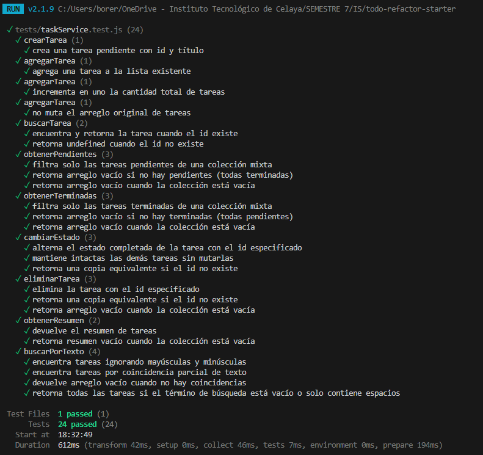

### Integración en la interfaz de usuario

Para cerrar el ciclo de la extensión, integramos la barra de búsqueda en `index.html` y la conectamos en `app.js` mediante el evento `input`, permitiendo filtrar las tareas en tiempo real mientras el usuario escribe:

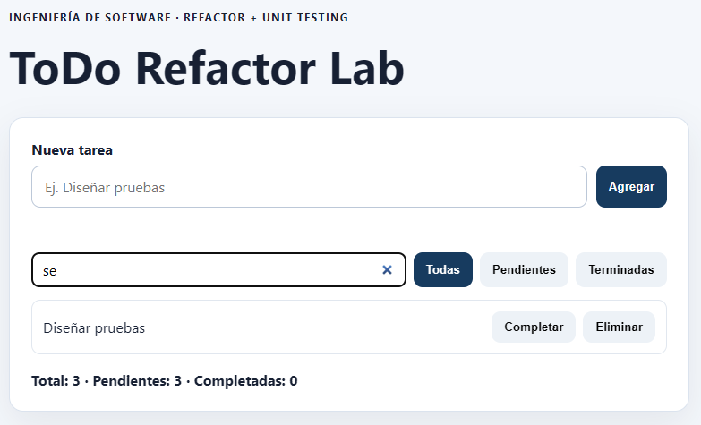

## Reflexión de pareja

Durante este laboratorio comprobamos en la práctica cómo la disciplina de diseño guiada por pruebas (TDD) y la separación rigurosa de responsabilidades transforman un código inicialmente frágil en una arquitectura confiable. El cambio que más incrementó la mantenibilidad del proyecto fue desacoplar el estado y las operaciones de dominio de la manipulación del DOM, concentrando las reglas en funciones puras e inmutables dentro de `taskService.js`. En la versión legacy, cualquier interacción modificaba directamente arreglos globales y elementos HTML, lo que dificultaba predecir efectos secundarios. Con el nuevo diseño, la interfaz en `app.js` actúa meramente como un adaptador que reacciona a eventos y renderiza el estado.

Por otro lado, las pruebas unitarias que mayor confianza aportaron fueron las de inmutabilidad en operaciones como `cambiarEstado` y `agregarTarea`. Verificar explícitamente que la referencia en memoria del arreglo resultante fuera distinta a la inicial (`expect(resultado).not.toBe(tareas)`) nos aseguró que nunca mutaríamos el estado original por descuido. Contar con una suite automatizada de 24 pruebas ejecutándose en milisegundos nos permitió refactorizar sin miedo a romper funcionalidades previas, demostrando que las pruebas no son un trámite posterior, sino una red de seguridad indispensable para evolucionar software de calidad.

