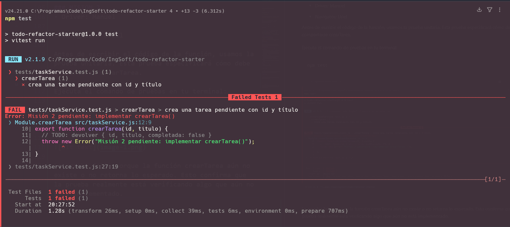
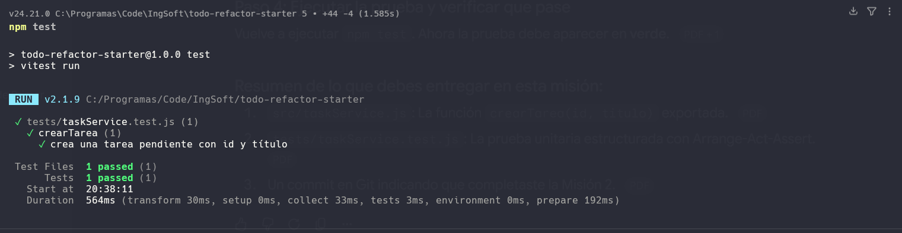
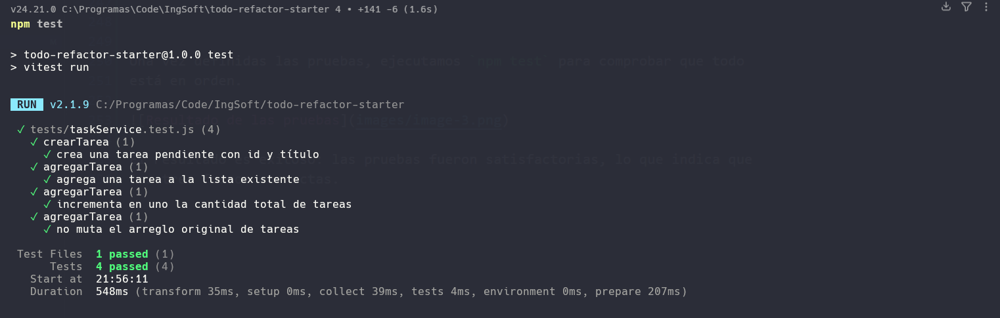
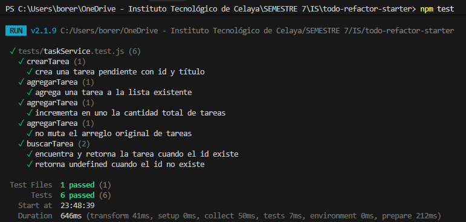

# ToDo Refactor Starter

Proyecto inicial para **ToDo Refactor Lab**: refactorización, pruebas unitarias y Pair Programming.

## Requisitos

- Node.js 18 o superior.
- npm, incluido con Node.js.

Comprueba las versiones instaladas:

```bash
node --version
npm --version
```

## Instalación

Clona el repositorio y entra en la carpeta del proyecto:

```bash
git clone <URL_DEL_REPOSITORIO>
cd todo-refactor-starter
```

Instala las dependencias:

```bash
npm install
```

## Ejecutar las pruebas

Ejecuta la suite de pruebas una vez:

```bash
npm test
```

Durante el desarrollo:

```bash
npm run test:watch
```

La primera prueba puede estar preparada para fallar: es el punto de partida de la
**Misión 2** y del ciclo **RED → GREEN → REFACTOR**.

## Ejecutar la aplicación

Abre `index.html` en un navegador o utiliza la extensión **Live Server** de
Visual Studio Code para servir el proyecto localmente. La aplicación se
encuentra en:

```text
http://localhost:5500/index.html
```

El puerto puede cambiar según la configuración de Live Server.

## Estructura

- `src/legacy.js`: código funcional simple para analizar antes de cambiar.
- `src/taskService.js`: lógica de dominio que completarás misión por misión.
- `src/app.js`: interfaz inicial; en la Misión 9 deberá delegar la lógica a `taskService.js`.
- `tests/taskService.test.js`: suite incremental de pruebas unitarias con Vitest.

## Registro RED → GREEN → REFACTOR

Documenta al menos una iteración:

- **RED:** ¿qué prueba escribiste y por qué falló?
- **GREEN:** ¿cuál fue el cambio mínimo que la hizo pasar?
- **REFACTOR:** ¿qué mejoraste sin cambiar el comportamiento?

## Pair Programming

Registra por misión quién fue **Driver** y quién **Navigator**. Intercambien roles con frecuencia y no hagan commit hasta que ambos puedan explicar el código y la prueba.

## Misión 0 · Antes de modificar código

1. ¿Dónde almacenarías ahora el estado `completada` de una tarea?
   Lo almacenaría en el local storage usando de base un archivo JSON.
2. ¿Qué ocurriría si mañana cada tarea necesita prioridad, fecha o responsable?
   Se debería de añadir un nuevo atributo al objeto de la tarea, ya que se planeo desde antes como un objeto JSON.
3. ¿Qué parte del código representa datos y qué parte representa interfaz?
   La interfaz está en el archivo index.html y los datos están en el archivo App.js, aun que en el futuro se planea moverlos a un JSON y se modificaran desde el archivo TaskService.js
4. ¿Qué comportamiento debemos conservar durante el refactor?
   Todo el comportamiento observable y funcionalidad para el usuario final, por ejemplo los botones y listas.

### Tres comportamientos observables que NO deben cambiar

1. Agregar tareas al DOM
2. Eliminar tareas del DOM
3. Contador de tareas


## Misión 1
- Driver: Manuel

- Navigator: Uriel

Las tareas pasaron de texto a ser representadas como objetos, no hubo ninguna complicación en su implementación debido a su sencillez.

```javascript
   let tareas = [
   {
      id: 0,
      titulo: "Revisar requisitos",
      completada: false
   },
   {
      id: 1,
      titulo: "Diseñar pruebas",
      completada: false
   },
   {
      id: 2,
      titulo: "Refactorizar código",
      completada: false
   }
   ];
```

## Misión 2

- **Driver:** Manuel
- **Navigator:** Uriel

### RED: escribir la prueba unitaria

Antes de escribir el código de la función, usamos una prueba unitaria. Esta
prueba especifica cómo debe comportarse `crearTarea`.

Ejecutamos el comando de pruebas en la terminal:

```bash
npm test
```



La prueba falló porque la función `crearTarea` aún no existe o no devuelve lo
esperado. Esto confirma que la prueba realmente está verificando algo que aún
no se ha implementado.

### GREEN: implementar el código mínimo

Una vez comprobado que la prueba unitaria está lista, escribimos el código
mínimo necesario para que pase:

```javascript
return {
  id: id,
  titulo: titulo,
  completada: false
};
```

Volvemos a ejecutar `npm test`.



Ahora la prueba aparece en verde, lo que indica que funcionó correctamente.

Con esta práctica entendimos mejor el propósito de las pruebas unitarias:
en lugar de realizar la prueba manualmente, solo se define el comportamiento y,
al ejecutar `npm test`, se verifica en milisegundos si la función devuelve el
objeto correcto.

## Misión 3

- **Driver:** Manuel
- **Navigator:** Uriel

Dada una lista de tareas y una nueva tarea, la función debe retornar una
colección que combine ambas. Para este problema, Uriel indicó que la solución
más sencilla, debido a su experiencia en el desarrollo web, sería utilizar el
operador spread (`...`). Este operador sirve para copiar todos los elementos
del arreglo original `tareas` y crear un nuevo arreglo.

```javascript
return [...tareas, nuevaTarea];
```

### Prueba 1: agregar una tarea a la lista

La prueba se diseñó para iniciar con el arreglo de tareas y la nueva tarea.
Después, se llama a `agregarTarea`. El resultado esperado es que la nueva
colección contenga `nuevaTarea`.

```javascript
describe("agregarTarea", () => {
  it('agrega una tarea a la lista existente', () => {
    // Arrange
    const tareasIniciales = [{ id: 1, titulo: "Tarea 1", completada: false }];
    const nuevaTarea = { id: 2, titulo: "Nueva tarea", completada: false };

    // Act
    const resultado = agregarTarea(tareasIniciales, nuevaTarea);

    // Assert
    expect(resultado).toContainEqual(nuevaTarea);
  });
});
```

### Prueba 2: Verificar que la nueva lista contiene un elemento extra

Se diseñó para comprobar que la nueva colección es más grande. Por ello, se
verifica que tenga un elemento más que la colección inicial; el resultado debe
ser `tareasIniciales.length + 1`.

```javascript
describe("agregarTarea", () => {
  it('incrementa en uno la cantidad total de tareas', () => {
    // Arrange
    const tareasIniciales = [{ id: 1, titulo: "Tarea 1", completada: false }];
    const nuevaTarea = { id: 2, titulo: "Tarea 2", completada: false };

    // Act
    const resultado = agregarTarea(tareasIniciales, nuevaTarea);

    // Assert
    expect(resultado.length).toBe(tareasIniciales.length + 1);
  });
});
```

### Prueba 3: Verifica que el nuevo arreglo no sea el mismo que el original (inmutabilidad) 
Para detectar si agregarTarea está modificando directamente el arreglo original recibido, se comprueba que el nuevo arreglo no sea igual al original, además de comprobar que la copia de este sea idéntica al original para asegurar que ni el contenido ni la referencia del arreglo original sean alterados.

```javascript
describe("agregarTarea", () => {
  it('no muta el arreglo original de tareas', () => {
    // Arrange
    const tareasIniciales = [{ id: 1, titulo: "Tarea 1", completada: false }];
    const copiaInicial = [...tareasIniciales]
    const nuevaTarea = { id: 2, titulo: "Tarea 2", completada: false };

    // Act
    const resultado = agregarTarea(tareasIniciales, nuevaTarea);

    // Assert
    expect(resultado).not.toBe(tareasIniciales); // Referencias distintas
    expect(tareasIniciales).toEqual(copiaInicial); // El contenido original no cambia
  });
});
```

Una vez definidas las pruebas, ejecutamos `npm test` para comprobar que todo
está en orden.



El resultado es exitoso: las pruebas fueron satisfactorias, lo que indica que
las tres de agregar tarea fueron correctas.

## Misión 4

- **Driver:** Uriel
- **Navigator:** Manuel

Se implementó la función pura `buscarTarea(tareas, id)` para localizar un elemento específico dentro de la colección por su identificador único.

### RED: escribir las pruebas unitarias

Escribimos dos pruebas unitarias para cubrir ambos escenarios (existente e inexistente):

1. **ID existente:** Debe encontrar y retornar el objeto de la tarea correspondiente.
2. **ID inexistente:** Debe retornar `undefined` de manera determinista sin arrojar excepciones.

```javascript
describe("buscarTarea", () => {
  it("encuentra y retorna la tarea cuando el id existe", () => {
    // Arrange
    const tareas = [
      { id: 1, titulo: "Primera tarea", completada: false },
      { id: 2, titulo: "Segunda tarea", completada: true }
    ];

    // Act
    const resultado = buscarTarea(tareas, 2);

    // Assert
    expect(resultado).toEqual({ id: 2, titulo: "Segunda tarea", completada: true });
  });

  it("retorna undefined cuando el id no existe", () => {
    // Arrange
    const tareas = [
      { id: 1, titulo: "Primera tarea", completada: false }
    ];

    // Act
    const resultado = buscarTarea(tareas, 999);

    // Assert
    expect(resultado).toBeUndefined();
  });
});
```

Al correr `npm test`, la suite falló como se esperaba porque `buscarTarea` lanzaba el error pendiente de implementación.

### GREEN: implementar el código mínimo

Implementamos la función utilizando el método de arreglo estándar de JavaScript `find()`, el cual devuelve el primer elemento que satisface la condición o `undefined` si no se encuentra:

```javascript
export function buscarTarea(tareas, id) {
  return tareas.find(tarea => tarea.id === id);
}
```

Al volver a ejecutar `npm test`, las 6 pruebas pasaron exitosamente (4 previas + 2 de la Misión 4).



